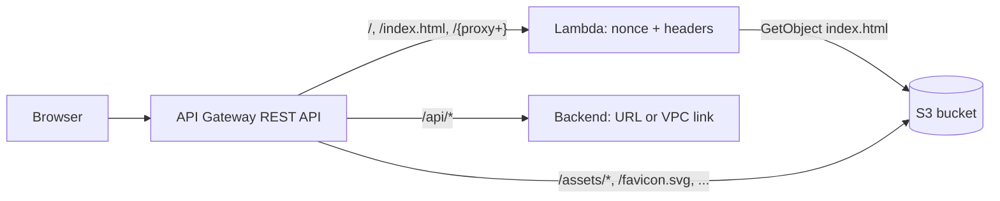

# cdk-spa-api-gateway

A CDK construct, `SpaApiGateway`, that serves a single-page app (SPA) from an API Gateway REST API:

- **`/`, `/index.html` and every other path** are served by a Lambda that injects a per-request CSP nonce into the HTML and sets the security headers. Client-side routes such as `/dashboard` work with `BrowserRouter`.
- **`/assets/{proxy+}` and a list of root files** (favicon, manifest, service worker) come straight from S3 through an API Gateway service integration, with no Lambda. S3 errors are mapped to [RFC 9457](https://www.rfc-editor.org/rfc/rfc9457) problem details.
- **`/api/{proxy+}`** is proxied to any backend with an HTTP proxy integration: a public website, or a private one through a VPC link.

The defaults cost almost nothing: no CloudFront, WAF, VPC link, load balancer, cache cluster or custom domain.



## Install

```bash
npm install cdk-spa-api-gateway
```

Requires `aws-cdk-lib` `^2.270.0`, `constructs` `^10.5.0` and Node.js 22 or later.

## Usage

```ts
import { SpaApiGateway } from 'cdk-spa-api-gateway';

const spa = new SpaApiGateway(this, 'Spa', {
  backend: { url: 'https://api.example.com' },
});

// Upload the build of your app, for example with BucketDeployment:
new BucketDeployment(this, 'Site', {
  sources: [Source.asset('dist')],
  destinationBucket: spa.bucket,
});
```

Your `index.html` marks where the nonce goes with `__CSP_NONCE__`:

```html
<script type="module" src="/assets/index.js" nonce="__CSP_NONCE__"></script>
<link rel="stylesheet" href="/assets/index.css" nonce="__CSP_NONCE__" />
```

The Lambda replaces every occurrence with a fresh nonce on each request and puts the same nonce in the `Content-Security-Policy` header.

A deployable example is in [`bin/`](bin). It uploads a small site and proxies `/api` to a public URL:

```bash
npx cdk deploy
```

To proxy `/api` to an EC2 instance behind an NLB and a VPC link instead (this costs money):

```bash
npx cdk deploy -c vpcBackend=true
```

## Routes

| Request                             | Served by                                                                  |
| ----------------------------------- | -------------------------------------------------------------------------- |
| `GET /`, `GET /index.html`          | Lambda                                                                     |
| `GET /{proxy+}` (any other path)    | Lambda, so client-side routes work. With `spaFallback: false`, S3 instead. |
| `GET`, `HEAD /assets/{proxy+}`      | S3, the object under `assets/`                                             |
| `GET`, `HEAD` each of `staticFiles` | S3, the object at that path                                                |
| `ANY /api`, `ANY /api/{proxy+}`     | The backend                                                                |

API Gateway uses the most specific resource, so the catch-all only receives paths that nothing else claims. Because of that, `/foo.js` that does not exist returns the app shell with a `200`; only paths under `/assets` and `staticFiles` return a `404` problem. See [docs/routing.md](docs/routing.md).

## Props

| Prop                    | Default                                                                          | Description                                                                                                                                                          |
| ----------------------- | -------------------------------------------------------------------------------- | -------------------------------------------------------------------------------------------------------------------------------------------------------------------- |
| `backend`               | required                                                                         | `{ url, vpcLink?, hostHeader? }` for `/api`: `/api/x` reaches `<url>/x`, so a backend under `/api` needs `https://host/api`. See [docs/backend.md](docs/backend.md). |
| `bucket`                | a new private, SSE-S3 bucket with SSL enforced                                   | Bucket holding `index.html` and the static assets.                                                                                                                   |
| `staticPaths`           | `['/assets/{proxy+}']`                                                           | Greedy paths served from S3. Each must end in `/{proxy+}`.                                                                                                           |
| `staticFiles`           | `/favicon.svg`, `/favicon.ico`, `/manifest.webmanifest`, `/sw.js`, `/robots.txt` | Fixed-path files served from S3.                                                                                                                                     |
| `spaFallback`           | `true`                                                                           | Serve `index.html` for every unmatched path. If `false`, `/{proxy+}` goes to S3.                                                                                     |
| `nonceToken`            | `__CSP_NONCE__`                                                                  | The placeholder in `index.html` replaced by the nonce.                                                                                                               |
| `contentSecurityPolicy` | see [docs/security-headers.md](docs/security-headers.md)                         | A CSP template; `{nonce}` is replaced by the nonce.                                                                                                                  |
| `additionalHeaders`     | none                                                                             | Extra or overriding response headers for the HTML.                                                                                                                   |
| `apiAuthorizer`         | none                                                                             | An `IAuthorizer` for the `/api` methods. By default the backend authenticates.                                                                                       |
| `accessLogging`         | `false`                                                                          | Write API access logs to CloudWatch Logs.                                                                                                                            |
| `logRetention`          | one week                                                                         | Retention of the Lambda and access log groups.                                                                                                                       |

The construct exposes `api` (the `RestApi`), `apiResource` (the `/api` resource, to add routes of your own), `bucket` and `indexFunction`.

## Defaults and cost

Everything that costs money is opt-in:

- No VPC link, NLB or EC2: `backend.vpcLink` is optional.
- No WAF, API cache cluster, X-Ray tracing or custom domain. Attach them to `api` yourself.
- No access logging, which needs the account-level API Gateway CloudWatch role.
- The Lambda is arm64 with 128 MB and one week of log retention.
- The bucket uses SSE-S3 rather than a KMS key, and is not versioned.

## Known limitations

- **Binary media types apply to the whole API.** The static files include fonts and images, so the API sets `binaryMediaTypes: ['*/*']`. This affects `/api` as well; the HTTP proxy passes bodies through unchanged.
- **API Gateway limits apply**: a 10 MB payload and a default 29 second integration timeout.
- **No conditional requests for static assets.** `If-None-Match` is not forwarded to S3, so a revalidation is a full response. Hashed assets are cached by the browser from the object's own `Cache-Control`, so set it on upload.
- **Nonces and service workers.** A service worker that caches `index.html` replays its nonce on every offline load. This is not handled by the construct.
- **`Host` override.** `backend.hostHeader` maps `integration.request.header.Host`; check that your backend sees it.

## cdk-nag

The defaults pass the AWS Solutions checks except for findings that follow from the design, each acknowledged with a reason in [`test/constructs/spa-api-gateway.nag.test.ts`](test/constructs/spa-api-gateway.nag.test.ts): logging and WAF are opt-in, the site is public, and the API role can read any object in the bucket. Review these for your own stack.

## Development

```bash
npm install
npm test          # builds the Lambda bundle, then jest with coverage
npm run lint
npm run format
npm run typecheck
npx cdk synth     # the sample stack in bin/
```

See [docs/](docs) for details on routing, security headers and the backend.

## License

MIT
